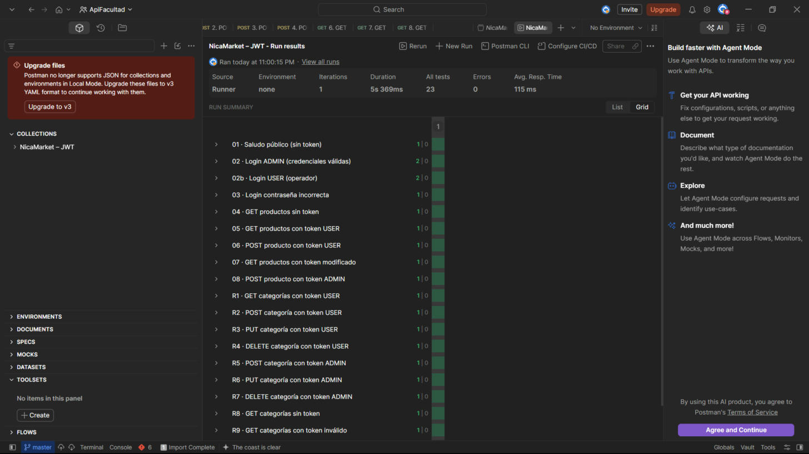
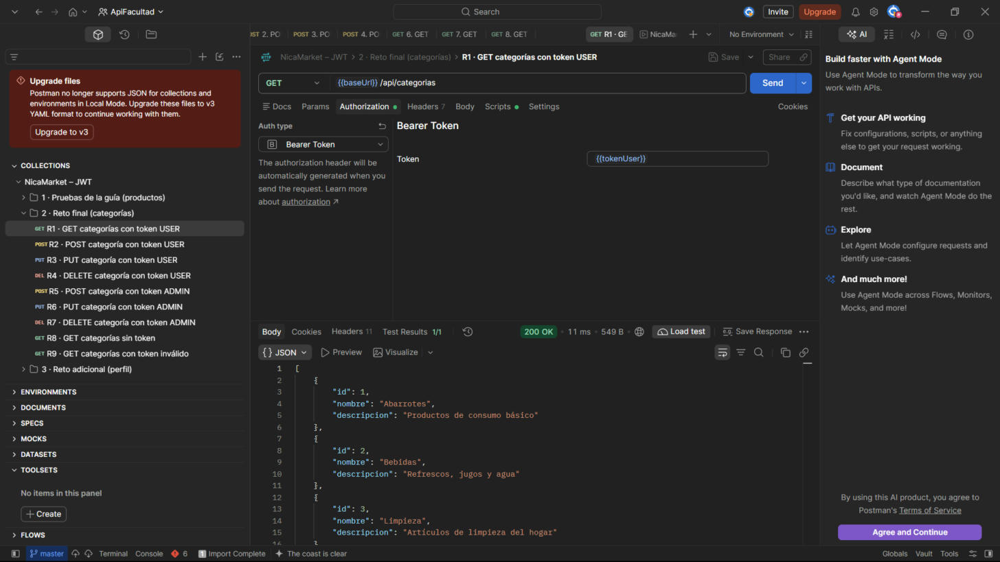
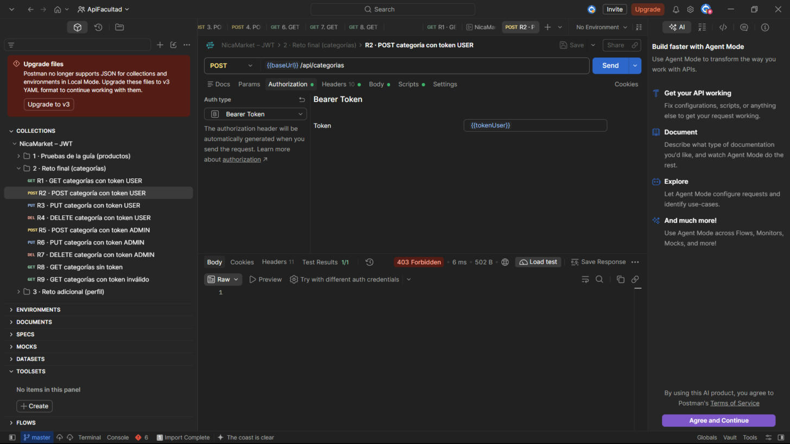
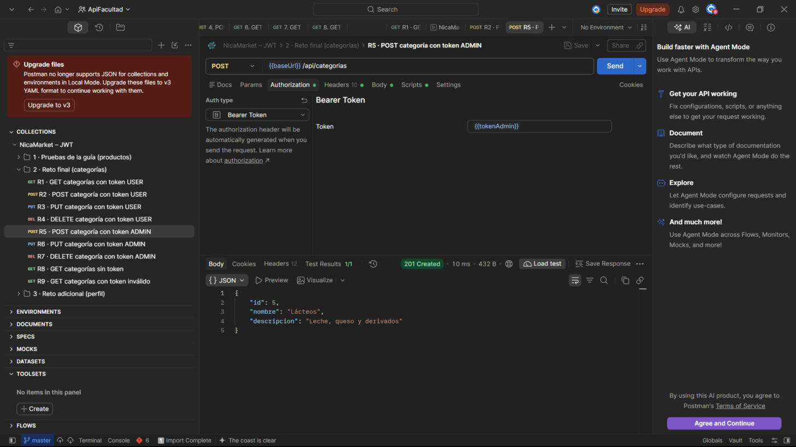
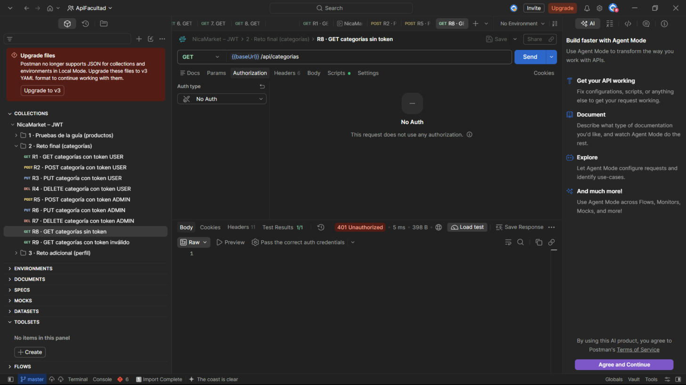
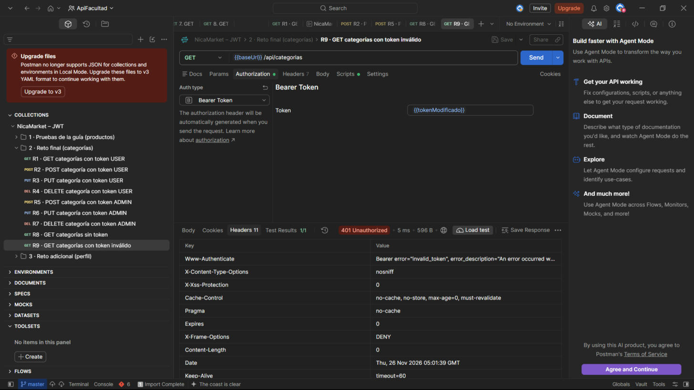
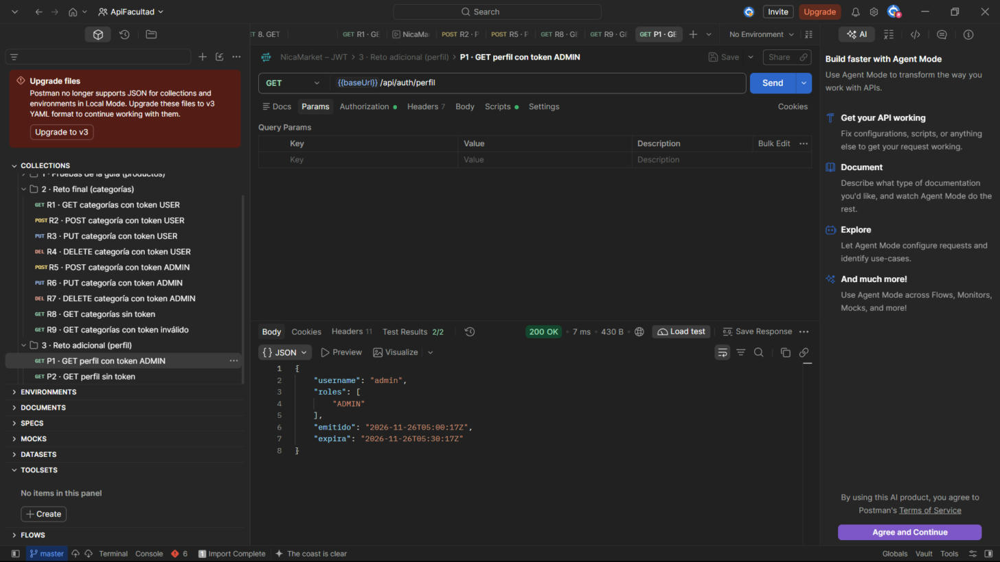

# NicaMarket API — Seguridad con Spring Security y JWT

Práctica guiada n.º 9 · Servicios Web (UAM) · Rama **`seguridad-jwt`**

API REST de **productos** y **categorías** del caso *Comercial NicaMarket, S. A.*, protegida con
autenticación JWT (HS256) y autorización por roles. Los datos viven en memoria (3 categorías y
4 productos iniciales) y se reinician al detener la aplicación.

- Java 21 · Spring Boot 4.1.1 · Spring Security 7 (OAuth2 Resource Server) · Maven
- Paquete base: `com.example.factura`

## 1. Configurar la clave JWT (obligatorio)

La clave **no está en el repositorio**. Se lee de la variable de entorno `JWT_SECRET_BASE64`
(32 bytes aleatorios en Base64).

1. Generar la clave en PowerShell:

   ```powershell
   $b = New-Object byte[] 32; [Security.Cryptography.RandomNumberGenerator]::Create().GetBytes($b); [Convert]::ToBase64String($b)
   ```

2. En IntelliJ IDEA: **Run → Edit Configurations… → FacturaApplication → Environment variables**
   y agregar `JWT_SECRET_BASE64=<valor generado>`.
3. Ejecutar `FacturaApplication`. El servidor queda en `http://localhost:8080`.

Si la variable falta, la aplicación no arranca y muestra *"Configure JWT_SECRET_BASE64 en IntelliJ"*.

## 2. Usuarios de laboratorio

| Usuario | Contraseña | Rol |
|---------|------------|-----|
| `admin` | `Admin123!` | ADMIN |
| `operador` | `Operador123!` | USER |

Credenciales solo para desarrollo; no deben usarse en producción.

## 3. Reglas de acceso

| Ruta | Método | Acceso |
|------|--------|--------|
| `/api/publico/saludo` | GET | Público |
| `/api/auth/login` | POST | Público (devuelve el JWT) |
| `/api/auth/perfil` | GET | Cualquier token válido |
| `/api/productos`, `/api/productos/{id}` | GET | USER, ADMIN |
| `/api/productos`, `/api/productos/{id}` | POST, PUT, DELETE | ADMIN |
| `/api/categorias`, `/api/categorias/{id}` | GET | USER, ADMIN |
| `/api/categorias`, `/api/categorias/{id}` | POST, PUT, DELETE | ADMIN |
| Cualquier otra ruta | — | Token válido |

El token se envía en el encabezado `Authorization: Bearer <token>` y vence a los 30 minutos.

## 4. Archivos agregados en esta rama

```
com/example/factura/
├── config/SecurityConfig.java       usuarios, AuthenticationManager, JwtEncoder/Decoder, reglas por rol
├── controllers/AuthController.java  POST /api/auth/login y GET /api/auth/perfil
├── dto/LoginRequest.java
├── dto/LoginResponse.java
├── services/TokenService.java       genera el JWT firmado (claims sub, roles, iat, exp, iss)
└── exception/ApiExceptionHandler    + 401 para credenciales incorrectas
```

Los controladores CRUD (`ProductoController`, `CategoriaController`) no se modificaron.

## 5. Pruebas en Postman

Importar `postman/NicaMarket-JWT.postman_collection.json` y ejecutar las carpetas **en orden**
(los requests de login guardan `tokenAdmin` y `tokenUser` en variables de la colección).

| # | Solicitud | Token | Esperado |
|---|-----------|-------|----------|
| 01 | GET `/api/publico/saludo` | Sin token | 200 |
| 02 | POST `/api/auth/login` (admin) | — | 200 + JWT |
| 03 | POST `/api/auth/login` contraseña incorrecta | — | 401 |
| 04 | GET `/api/productos` | Sin token | 401 |
| 05 | GET `/api/productos` | USER | 200 |
| 06 | POST `/api/productos` | USER | 403 |
| 07 | GET `/api/productos` | Token modificado | 401 |
| 08 | POST `/api/productos` | ADMIN | 201 |
| R1 | GET `/api/categorias` | USER | 200 |
| R2–R4 | POST / PUT / DELETE `/api/categorias` | USER | 403 |
| R5–R7 | POST / PUT / DELETE `/api/categorias` | ADMIN | 201 / 200 / 204 |
| R8 | GET `/api/categorias` | Sin token | 401 |
| R9 | GET `/api/categorias` | Token inválido | 401 |
| P1 | GET `/api/auth/perfil` | ADMIN | 200 (usuario y roles) |
| P2 | GET `/api/auth/perfil` | Sin token | 401 |

Resultado de la ejecución completa (Runner): **23 de 23 pruebas superadas, 0 fallidas**.



### Cinco evidencias del reto final y por qué se obtuvo cada código

1. **R1 · GET categorías con USER → 200 OK.** El token es válido (firma y vencimiento correctos) y
   el claim `roles` contiene `USER`, que tiene permiso de consulta.

   

2. **R2 · POST categoría con USER → 403 Forbidden.** El usuario sí está autenticado, pero crear
   categorías exige `ROLE_ADMIN`: falla la autorización, no la autenticación.

   

3. **R5 · POST categoría con ADMIN → 201 Created.** El rol ADMIN tiene permiso y los datos cumplen
   las validaciones de la entidad, así que la categoría se crea.

   

4. **R8 · GET categorías sin token → 401 Unauthorized.** La ruta está protegida y la petición no
   trae `Authorization`, por lo que no hay identidad que autorizar.

   

5. **R9 · GET categorías con token modificado → 401 Unauthorized.** Al alterar el token, la firma
   HS256 ya no coincide y `JwtDecoder` lo rechaza.

   

### Reto adicional: perfil



## 6. Preguntas de cierre

**¿En qué se diferencian HTTP 401 y 403?** 401 significa que no se pudo autenticar: falta el token,
está vencido o su firma no es válida. 403 significa que la identidad sí se reconoció, pero su rol no
tiene permiso para esa operación (por ejemplo, USER intentando crear una categoría).

**¿Por qué no basta con leer el contenido de un JWT para confiar en él?** El payload solo está
codificado en Base64URL, no cifrado: cualquiera puede leerlo o escribir uno nuevo con
`"roles": ["ADMIN"]`. Lo que da confianza es la firma, que solo puede producir quien conoce la clave,
junto con la verificación del vencimiento.

**¿Qué función cumple `JwtDecoder`?** Recibe el token del encabezado `Authorization`, verifica la
firma HS256 con la clave secreta, comprueba `exp` y la estructura, y devuelve un `Jwt` con los
claims. Si falla cualquier paso, Spring Security responde 401.

**¿Qué riesgos ocasionaría publicar la clave utilizada para firmar tokens?** Cualquiera podría
fabricar tokens válidos con el usuario y los roles que quisiera (por ejemplo ADMIN) y modificar o
borrar productos y categorías sin credenciales. Habría que cambiar la clave, lo que invalida todos
los tokens emitidos. Por eso la clave va en una variable de entorno y no en el repositorio.

## 7. Seguridad del repositorio

No se incluyen la clave `JWT_SECRET_BASE64` ni tokens: las variables de token de la colección de
Postman se exportan vacías y se llenan al ejecutar los logins.
